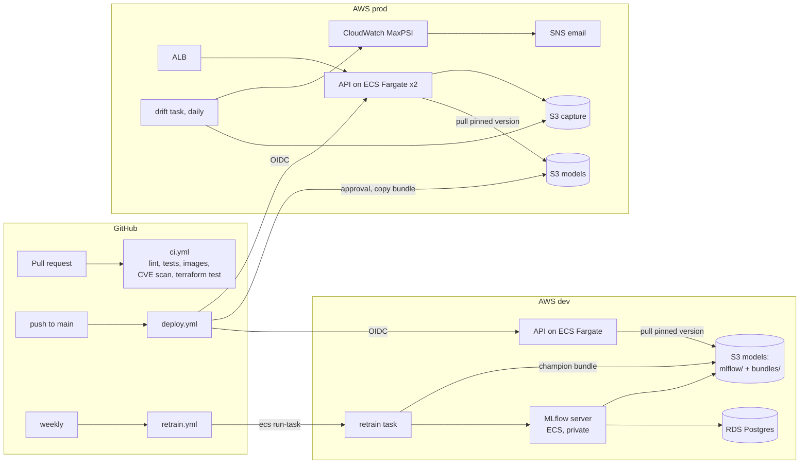

# Architecture

## Components

## Request path

1. Client → ALB (HTTP, or HTTPS when a certificate is configured) → API task on port 8000. Task security group accepts traffic only from the ALB.
2. FastAPI validates the payload with Pydantic (types, ranges, allowed categories) and returns 422 on bad input.
3. The model scores the batch. Each request is logged as one JSON line (path, status, latency) to CloudWatch Logs.
4. Inputs and scores are buffered and written to S3 in batches (`capture/dt=YYYY-MM-DD/…jsonl`). A capture failure is logged and never fails the request.

## Model path

1. `retrain` runs as an ECS task in dev: generate/load data, train, log params, metrics, model and training profile to MLflow, register the new version as `@challenger`.
2. The quality gate scores nothing new: it reads metrics computed on the frozen holdout set and compares challenger vs champion. Pass → `@champion` moves, the old champion becomes `@previous-champion`. Fail → exit code 1, EventBridge sees the non-zero exit and emails the team.
3. `export` writes `model.joblib`, `metadata.json` and `profile.json` to `s3://…/bundles/v<N>/` and updates `bundles/champion.json`.
4. `deploy.yml` reads `champion.json`, applies Terraform with `model_version=N`. ECS starts new tasks that download exactly v<N>; the ALB only shifts traffic once `/health` passes; if they never get healthy, the circuit breaker rolls back.
5. After approval, the same bundle is copied to the prod bucket and prod is applied with the same image tag and the same model version.

## Environments

| | dev | prod |
|---|---|---|
| Purpose | ML workspace + integration | serving only |
| MLflow + RDS | yes | no |
| Retraining | weekly via GitHub, on demand | never; receives bundles from dev |
| API tasks | 1-2 | 2-6, two AZs |
| Deletion protection | off | on (RDS, ALB, buckets kept) |
| Log retention | 7 days | 90 days |
| Deploy | automatic on main | GitHub environment with required reviewer |

Both are `module "stack"` with different inputs, so they cannot drift structurally.

## Security model

- **No long-lived credentials.** GitHub Actions gets 1-hour AWS credentials through OIDC. The `ci` role can push images and plan; `deploy-dev` / `deploy-prod` can only be assumed by jobs running in the matching GitHub environment, so prod credentials require the approval step.
- **Least privilege per task.** The API can `PutObject` to `capture/*` and `GetObject` on `bundles/*`, nothing else. Jobs can publish metrics only to the `ChurnModel` namespace.
- **Secrets.** The RDS password is generated by AWS in Secrets Manager (`manage_master_user_password`) and injected into the MLflow task by ECS; it never appears in Terraform state or code.
- **Network.** RDS accepts connections only from MLflow; MLflow only from the jobs security group; API tasks only from the ALB.
- **Containers.** Non-root user, read-only root filesystem for the API, images scanned by Trivy in CI and by ECR on push, immutable tags.
- **Supply chain.** All Python dependencies pinned to exact versions with `uv pip compile`; Dependabot for pip, Actions, Docker and Terraform.
